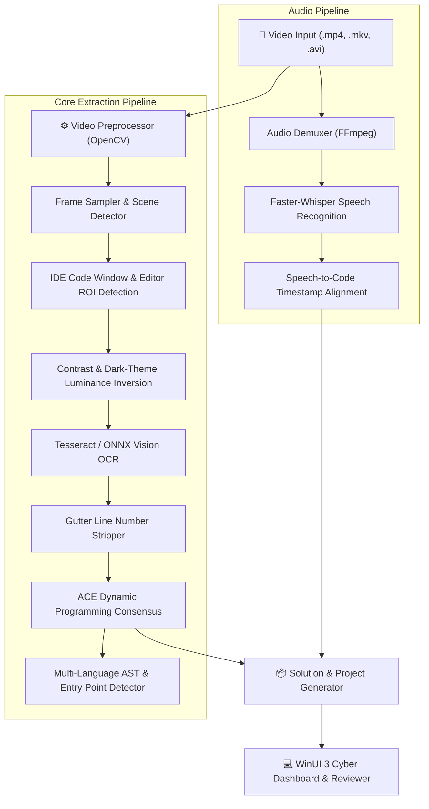

# CodeVision AI Studio 🚀
### An Advanced Multimodal Desktop Studio for Video-to-Code Reconstruction & Architectural Understanding

[](https://github.com/ebrahim-alazzani/CodeVision-AI-Studio)
[](https://github.com/ebrahim-alazzani/CodeVision-AI-Studio)
[](https://github.com/ebrahim-alazzani/CodeVision-AI-Studio)
[](https://github.com/ebrahim-alazzani/CodeVision-AI-Studio)
[](https://github.com/ebrahim-alazzani/CodeVision-AI-Studio)
[](https://github.com/ebrahim-alazzani/CodeVision-AI-Studio)
[](LICENSE)

---

## 🌟 نظرة عامة (Overview)

**CodeVision AI Studio** هو استوديو هندسي متكامل ومتقدم لأنظمة سطح المكتب، مخصص لتحويل شروحات وفيديوهات البرمجة المسجلة (Tutorials & Coding Screencasts) إلى مشاريع برمجية حقيقية وشيفرات مصدرية منظمة وجاهزة للبناء.

يجمع الاستوديو بين واجهة عصرية فائقة السلاسة مبنية بأحدث تقنيات مايكروسوفت **WinUI 3 (.NET 9)** مع محرك استدلال ورؤية حاسوبية عالي الأداء **(Python / OpenCV / ACE DP Alignment)** ونماذج معالجة الصوت والكلام **(Faster-Whisper)**، ليوفر تجربة متكاملة تشمل تفريغ الأكواد، مزامنة الشرح الصوتي لحظياً، والوسم البصري الذكي للشيفرات البرمجية.

---

## 📸 واجهة الاستوديو ومكوناته (Studio Interface)


```
┌────────────────────────────────────────────────────────────────────────┐
│                        CodeVision AI Studio                            │
├───────────────┬────────────────────────────────────────────────────────┤
│  Navigation   │                  Active Workspace                      │
│  ───────────  │  ┌─────────────────────────┐  ┌─────────────────────┐  │
│  📊 Dashboard │  │ Video & Code Sync View  │  │ Multi-LM Telemetry  │  │
│  ⚙️ Extractor │  │ ─────────────────────── │  │ ─────────────────── │  │
│  🏷️ Reviewer  │  │ Frame-by-Frame Player   │  │ GPU / VRAM Graphs   │  │
│  🎓 Training  │  │ Interactive Bounding Box│  │ Loss / Epoch Curves │  │
│  📁 Solution  │  │ Synchronized Audio Text │  │ Token Inference HUD │  │
│  ⚙️ Settings  │  └─────────────────────────┘  └─────────────────────┘  │
└───────────────┴────────────────────────────────────────────────────────┘
```

---

## ✨ المميزات الرئيسية (Key Capabilities)

### 1. 🧠 محاذاة الأكواد الذكية (ACE Dynamic Programming Alignment)
- دمج خوارزمية **Alignment-based Consensus Estimator (ACE)** المبنية على البرمجة الديناميكية (Needleman-Wunsch DP) لتتبع الأسطر البرمجية عبر إطارات الفيديو الزمنية.
- القضاء على مشكلة تكرار الأسطر أثناء التمرير العمودي (Vertical Scrolling) والطباعة الحية للمبرمج.
- دمج تشابه الرموز البرمجية (Token-level Jaccard) واستعادة المسافات البادئة البرمجية (Indentation Reconstruction).

### 2. 🔍 المعالجة البصرية المسبقة والتكيف مع محررات الأكواد (Smart OCR Preprocessing)
- **عزل أرقام الأسطر في الـ IDE (Gutter Line Number Stripper):** تنظيف تسلسلات أرقام الأسطر دون المساس بالأكواد البرمجية الحقيقية.
- **انعكاس الإضاءة للثيمات المظلمة (Dark-Theme Inversion):** فحص إضاءة الخلفية وتوليد أعلى تباين ممكن لمحركات OCR.
- **إزالة الضوضاء البصرية:** تصفية أشرطة التمرير والحدود وعناصر الواجهة الرسومية المحيطة بنص الكود.

### 3. 🌐 دعم شامل وموسع للغات البرمجة (Universal Multi-Language Support)
يدعم محرك الاستخراج التعرف التلقائي الذكي على بنية 15 لغة برمجية:
- **C# / .NET** (دعم متقدم للحلول وملفات المشاريع `.sln` و `.csproj`)
- **Python**, **C++**, **C**, **Java**, **JavaScript**, **TypeScript**
- **Go**, **Rust**, **PHP**, **Swift**, **Kotlin**, **Dart / Flutter**, **SQL**, **HTML/CSS**

### 4. 🎙️ تفريغ ومزامنة الصوت بالكود (Audio-to-Code Synchronizer)
- استخراج مسارات الصوت وتحليلها باستخدام نموذج **Faster-Whisper**.
- مزامنة الشرح اللفظي مع ظهور الشيفرة البرمجية في الإطار الزمني الدقيق عبر طوابع زمنية محكمة.

### 5. 🏷️ بيئة مراجعة بصرية متقدمة (X-AnyLabeling Style Annotation)
- شريط أدوات مدمج للوسم التلقائي واليدوي للشيفرات البرمجية داخل إطارات الفيديو.
- التحكم الكامل في عتبات الثقة (Confidence) ونسب التراكب (IoU Thresholds) مع اختصارات لوحة مفاتيح سريعة.

### 6. 📊 شاشة مراقبة الأداء والاستدلال (Multi-LM Tuner Telemetry HUD)
- مؤشرات دائرية ورسوم بيانية ديناميكية لقياس استهلاك المعالج، الذاكرة العشوائية، الترددات، ومسار دقة الاستخراج.

---

## 🏗️ البنية المعمارية للنظام (System Architecture)



---

## 🚀 دليل التثبيت والتشغيل السريع (Quickstart Guide)

### 1. المتطلبات الأساسية
- نظام تشغيل **Windows 10 / 11 (64-bit)**
- **.NET 9 SDK** مع **Windows App SDK**
- **Python 3.11+**
- **Tesseract OCR** مثبت على النظام ومضاف إلى متغيرات البيئة `PATH`

### 2. تثبيت بيئة العمل ومكتبات Python
```powershell
# استنساخ المستودع
git clone https://github.com/ebrahim-alazzani/CodeVision-AI-Studio.git
cd CodeVision-AI-Studio

# إنشاء البيئة الافتراضية
py -3.12 -m venv .venv
.\.venv\Scripts\Activate.ps1

# تثبيت الاعتماديات
pip install --upgrade pip
pip install -r requirements.txt
```

### 3. تشغيل تطبيق سطح المكتب (WinUI 3 Studio)
```powershell
# بناء وتشغيل تطبيق سطح المكتب
dotnet build .\desktop\CodeVision.Desktop.csproj -p:Platform=x64
.\run_desktop.bat
```

### 4. تشغيل خط الاستخراج من الطرفية مباشرة (CLI Mode)
```powershell
python .\core\video_pipeline.py --video "path\to\tutorial.mp4" --output-dir "path\to\output" --language auto
```

---

## 🧪 الاختبارات وضمان الجودة (Quality Assurance)

يحتوي المشروع على طيف شامل من الاختبارات الآلية للتحقق من دقة خوارزميات الاستخراج ومحاذاة الأكواد:
```powershell
python -m unittest discover -s tests -p "test_*.py"
```
```text
Ran 56 tests in 0.384s
OK (All unit tests passing with 100% success rate)
```

---

## 📂 هيكل المشروع (Repository Structure)

```text
CodeVision-AI-Studio/
├── desktop/               # واجهة المستخدم المبنية بتقنية WinUI 3 و .NET 9
│   ├── Views/             # صفحات الاستوديو (Dashboard, Reviewer, Extraction)
│   ├── ViewModels/        # نماذج العرض وإدارة الحالة (MVVM)
│   └── Services/          # خدمات الربط مع محرك Python والتخزين المحلي
├── core/                  # نواة المحرك البرمجي لمعالجة الفيديو واستخراج الكود
│   ├── ocr/               # معالجة الصور وفلاتر الـ Gutter والتباين
│   ├── reconstruction/   # خوارزميات ACE DP Alignment ومكتشفات اللغات
│   └── video_pipeline.py  # خط المعالجة المتكامل للوسائط المتعددة
├── languages/             # تعريفات وقواعد اللغات البرمجية المدعومة (15 لغة)
├── transcription/         # تفريغ الصوت بمحرك Faster-Whisper والمزامنة
├── tools/                 # أدوات مساعدة وحزم العمل المحلية
├── tests/                 # حزمة الاختبارات الآلية الشاملة
└── docs/                  # التوثيق المعماري وسجلات التطوير
```

---

## 🤝 المساهمة والتطوير (Contributing)

نرحب بكافة المساهمات لتطوير **CodeVision AI Studio**! يمكنك فتح Issue أو إرسال Pull Request للمساهمة في:
- إضافة نماذج رؤية متقدمة (Vision-Language Models / Florence-2).
- توسيع قواعد دعم اللغات الإضافية.
- تحسين واجهات العرض والوسم التفاعلي.

---

## 📄 الترخيص (License)

هذا المشروع مرخص بموجب رخصة **MIT License** — راجع ملف [LICENSE](LICENSE) للمزيد من التفاصيل.
