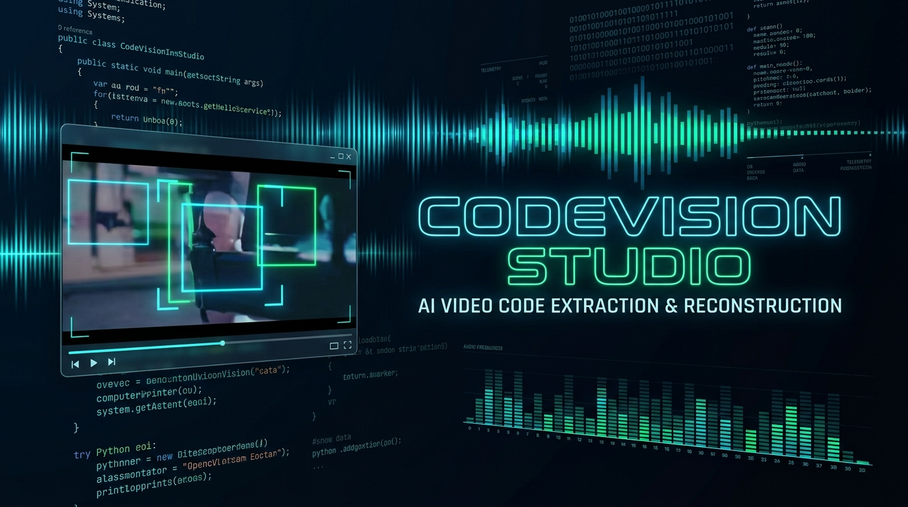
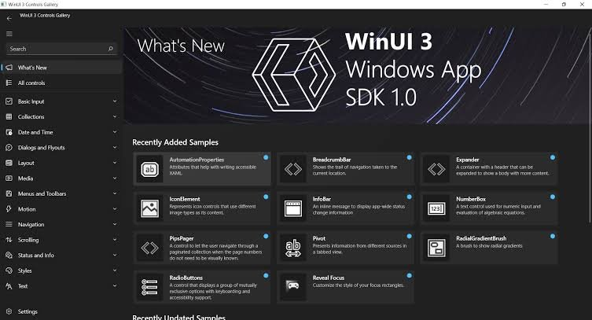
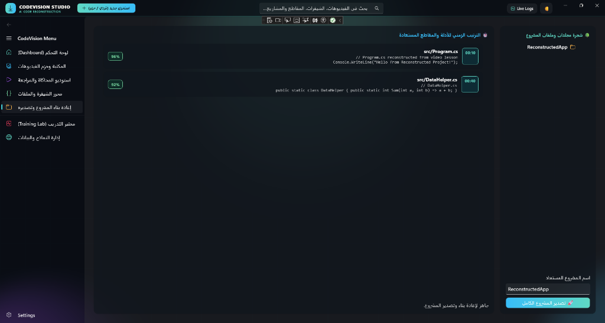
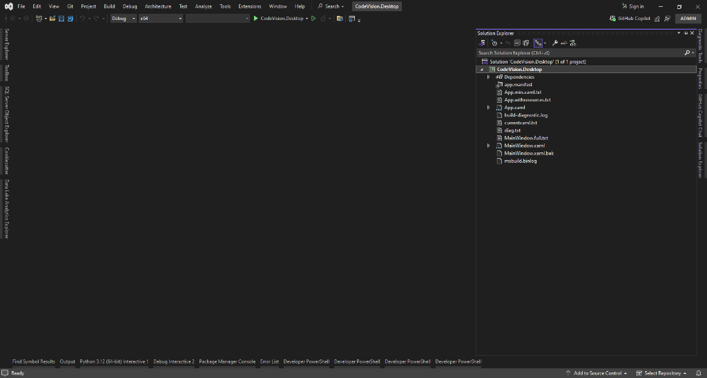

# ⚡ CodeVision Studio · Cyber AI Edition

<div align="center">




**استوديو الذكاء الاصطناعي المتطور لاستخراج وتتبع الأكواد وإعادة بناء مشاريع البرمجة والألعاب من مقاطع الفيديو التعليمية.**

*Next-Generation AI Desktop Studio for automated code extraction, visual ROI tracking, and complete C# / Unity architecture reconstruction from programming video tutorials.*

</div>

---

## 🌟 نبذة عن المشروع (Overview)

**CodeVision Studio** هو منصة سطح مكتب متقدمة مبنية باستخدام **WinUI 3 و .NET 9**، متصلة بمحرك بايثون هجين فائق الأداء يعتمد على تقنيات الرؤية الحاسوبية (**OpenCV**) واستخراج النصوص (**Tesseract 5.4.0 AVX2**) ومعالجة الصوتيات وتفريغ الكلام اللحظي (**FFmpeg & Faster-Whisper**).

يتفوق التطبيق في استخراج وتتبع الأكواد البرمجية من الفيديوهات التعليمية (مثل دورات تطوير الألعاب Unity C# وتطبيقات Python) وتحويل المشاهد المصورة إلى **مشروع برمجي حقيقي متكامل** يحتوي على ملفات الحل (`.sln`)، وملفات المشروع (`.csproj`)، وهيكلية مجلدات نظيفة ومطابقة لأفضل الممارسات المعمارية.

---

## 📸 معارض وواجهات الاستوديو (Studio Previews)

<div align="center">

### 1. استوديو المحاكاة والتتبع البصري اللحظي (OpenCV Real-time Simulation Studio)

<p><i>متابعة رصد OpenCV لمنطقة الكود مع الإطار المتوهج (Glowing Bounding Box)، المسار الصوتي، السجل الحي، وتفريغ Faster-Whisper.</i></p>

### 2. استوديو إعادة بناء وهندسة المشروع وتصديره (Project Architecture & Export Studio)

<p><i>شجرة ملفات المشروع المتكاملة، الترتيب الزمني للأدلة، معاينة وتحرير الأكواد، وتصدير حل فيجوال ستوديو (.sln / .csproj).</i></p>

### 3. لوحة التحكم والعمليات المجمعة (Dashboard & Batch Engine)

<p><i>إحصائيات المعالجة ومؤشرات الأداء ومراقبة تقدم التحليل المتوازي.</i></p>

</div>

---

## 🚀 المميزات الرئيسية (Key Features)

### 1. 👁️ تتبع بصري مباشر لمنطقة الشيفرة (OpenCV Code ROI Tracking)
* تحليل الإطارات وتتبع التغيرات الحركية والبصرية (`Frame Differencing` و `Canny Edge Detection`).
* عزل تلقائي لنافذة محرر الأكواد وتجاهل شاشات المحاضر وكاميرا الويب ومناطق العرض الجانبية.
* رسم إطار توجيهي متوهج ديناميكي (`Glowing Bounding Box`) يوضح نسبة الثقة ودقة الكود لكل مشهد.
* تجاوز الإطارات المكررة (`SSIM / Diff Score Fast Skip`) لتوفير الوقت واستهلاك المعالج.

### 2. 🧠 خوارزمية الدمج والتطور الزمني للكود (`SequenceMatcher Chronological Reconstruction`)
* استخدام خوارزمية مطابقة السلاسل (`difflib.SequenceMatcher`) عبر الإطارات المتعاقبة لدمج التعديلات التراكمية التي يكتبها المحاضر سطرًا بسطر.
* الاحتفاظ بسجل لقطات التطور البرمجي (`ScriptHistory`) لكل كلاس من أول إطار وحتى النسخة النهائية (`FINAL`).

### 3. 🛡️ فلتر تنقية الشوشرة والتصحيح اللغوي الذكي (`NoiseFilter`)
* إزالة عناصر واجهة بيئات التطوير (Visual Studio / VS Code UI Chrome) مثل أرقام الأسطر، القوائم العلوية، شريط الحالة، ونوافذ الإكمال التلقائي.
* تصحيح تلقائي للأخطاء الإملائية الشائعة الناتجة عن الـ OCR لكلمات C# و Unity (مثل `MonoBehaviour`, `FindObjectOfType<T>`, `GetComponent`, `Transform`, `GameObject`).

### 4. 🏗️ المصنف المعماري التلقائي لمشاريع Unity (`ScriptCategorizer`)
* توزيع وتنظيم الكلاسات المستعادة تلقائياً ضمن مجلدات معمارية معيارية:
  * 🎯 `Shooting/` (مثل: `ShootingController.cs`)
  * 🚗 `Vehicles/` (مثل: `CarController.cs`, `CarInteraction.cs`)
  * 🤖 `AI/` (كلاسات الأعداء والشرطة والمسارات `Waypoint`)
  * 🎮 `Player/` (التحكم بالحركة والقفز والتفاعل)
  * 🎥 `Camera/`, 🖥️ `UI/`, 💾 `Data/`

### 5. 🎙️ استخراج وتفريغ الصوت المتزامن (Faster-Whisper & FFmpeg)
* استخراج المسار الصوتي للفيديو وتحويله إلى صيغة `16 kHz Mono WAV` عبر FFmpeg.
* تفريغ الكلام المسموع ومزامنته بدقة مع التوقيت الزمني للمشاهد البرمجية (`Timed Commentary`).

### 6. 💻 استوديو إعادة البناء والتصدير بنقرة واحدة (Project Reconstruction Studio)
* شجرة مشروع تفاعلية مع إحصاء دقيق لعدد الملفات والأسطر البرمجية.
* شاشة معاينة فورية وتحرير للكود مع إمكانية نسخ الشيفرات بنقرة واحدة.
* تصدير بنية المشروع الكاملة مع توليد تلقائي لملفات `.sln` و `.csproj` وتقرير التحقق `RECONSTRUCTION_REPORT.md`.

---

## 🏛️ الهيكلية المعمارية (Architecture)

```text
CodeVisionPhase1/
├── desktop/                         # WinUI 3 + C# .NET 9 Desktop Client
│   ├── Views/                      # واجهات الاستوديو العصرية (Halvo Glassmorphism)
│   │   ├── DashboardPage.xaml      # لوحة التحكم ومؤشرات الأداء
│   │   ├── LibraryPage.xaml        # مكتبة حزم الفيديوهات
│   │   ├── ExtractionReviewPage.xaml # استوديو المحاكاة والتتبع اللحظي
│   │   ├── ProjectReconstructionPage.xaml # استوديو إعادة بناء وتصدير المشاريع
│   │   └── TrainingLabPage.xaml    # مختبر التدريب والبيانات
│   ├── ViewModels/                 # MVVM Toolkit Controllers
│   ├── Services/                   # تكامل بايثون، استخراج الصوت، وتصدير المشاريع
│   └── Models/                     # نماذج البيانات والمشاهد
│
├── core/                            # محرك الاستخراج والمعالجة (Python 3.13)
│   ├── video_pipeline.py           # خط أنابيب الاستخراج والتحليل الرئيسي
│   ├── ocr/                        # محرك Tesseract AVX2 وفلتر التنقية
│   │   ├── tesseract_engine.py
│   │   └── noise_filter.py
│   └── reconstruction/             # محركات التجميع والتصنيف الزمني
│       ├── script_builder.py
│       ├── line_merger.py
│       ├── class_detector.py
│       └── script_categorizer.py
└── CodeVision.sln                   # حل فيجوال ستوديو الرئيسي
```

---

## ⚙️ متطلبات التشغيل (Prerequisites & Installation)

### 1. بيئة التطوير (Desktop)
* **Windows 10 / 11** (x64)
* **.NET 9.0 SDK**
* **Windows App SDK 1.6+**

### 2. محرك البايثون (Python Engine)
* **Python 3.11 - 3.13**
* تثبيت الحزم المطلوبة:
```bash
pip install opencv-python-headless pillow imageio imageio-ffmpeg faster-whisper pytesseract
```

### 3. بناء وتشغيل المشروع
```bash
# بناء التطبيق عبر الـ CLI
dotnet build CodeVision.sln -p:Platform=x64

# أو التشغيل المباشر
cd desktop
dotnet run -p:Platform=x64
```

---

## 👨‍💻 المطور (Author)
* **م. إبراهيم أنس العزاني** (Eng. Ibrahim Anas Al-Azzani)
* *CyberPro for Technical & Engineering Works*

---

<div align="center">
  <b>CodeVision Studio · Empowering Code Extraction from Motion to Source</b>
</div>
