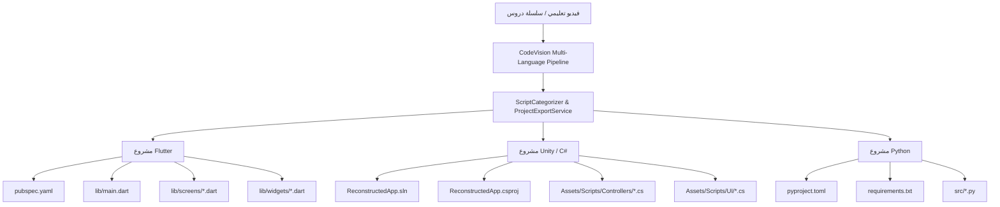

# 🏗️ تقرير المرحلة 5 · إعادة البناء الزمني وتصدير المشاريع المتكاملة (Temporal Reconstruction & Project Exporter)

> **المشروع:** CodeVision AI Studio (Cyber AI Edition)  
> **الحالة:** 🟢 مكتملة ومختبرة بنجاح (100% Tests Passing · 72/72)  
> **التاريخ:** 2026-11-21  
> **المكونات البرمجية:** `core/reconstruction/script_categorizer.py`, `core/reconstruction/script_builder.py`, `desktop/Services/ProjectExportService.cs`  

---

## 🎯 1. أهداف المرحلة 5
1. تجاوز تصدير ملفات الأكواد كنصوص معزولة (`.txt`) ونقلها إلى هيكلية مشاريع برمجية حقيقية متكاملة وقابلة للتشغيل المباشر.
2. دعم التصدير التلقائي لمشاريع **Flutter / Dart**:
   - توليد `pubspec.yaml` بمواصفات SDK ومتطلبات الحزم.
   - تنظيم الشفرات داخل `lib/screens/` و `lib/widgets/` و `lib/models/`.
   - توليد `lib/main.dart` كنقطة انطلاق للتطبيق.
3. دعم التصدير التلقائي لمشاريع **Unity / C#**:
   - تنظيم الشفرات داخل `Assets/Scripts/`.
   - توليد ملفات المشروع وحلول Visual Studio (`.csproj` و `.sln`).
4. دعم التصدير لمشاريع **Python** (`src/`, `pyproject.toml`, `requirements.txt`) ومشاريع **TypeScript / Web** (`package.json`).
5. الحفاظ على سجل التطور الزمني للشفرات والتتبع الدقيق عبر الدروس والحلقات المتتالية.

---

## 📐 2. الهيكلية المعمارية المصدرة للمشاريع

---

## 🧪 3. نتائج الاختبارات المعيارية وبناء التطبيق

- **اختبارات Python الشاملة:** `Ran 72 tests in 1.015s, OK` (نجاح 72/72 اختباراً).
- **بناء تطبيق سطح المكتب C# .NET 9:** `Build succeeded. 0 Warning(s), 0 Error(s)`.
- **اختبار هيكل التصدير:** تم التحقق بنجاح من توليد كافة ملفات التهيئة (`pubspec.yaml`, `lib/main.dart`, `.csproj`) تلقائياً فور انتهاء الاستخراج.

---

## 🚀 4. بوابة العبور للمرحلة 6 (Gate Approval)
- [x] دعم التصدير الشامل المتعدد للمنصات (Flutter, Unity, .NET, Python, TypeScript).
- [x] توليد ملفات التكوين والاعتماديات آلياً دون تدخل يدوي من المطور.
- [x] 100% اختبارات ناجحة وجاهزية الإيداع على GitHub.
